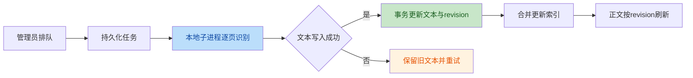

# 真实材料处理适配

沿用 documents、chunks、阅读授权和结构分块。原件保持不变，处理任务通过 documents.meta_json 保存状态、进度和质量摘要；单个后台工作线程执行、重启续跑，逐页结果在本地按原件哈希缓存。管理人员可在文档中心启动或重试，普通读者只看处理质量。

PDF 先提取可复制文字，只对缺少有效正文的页面运行离线 OCR：macOS Vision 或本地具备中文语言包的 Tesseract。识别文字保持物理页码，标明 OCR 与人工核对边界；失败、低置信度、截断和少字页面不得标为完整。没有本地引擎时保留原文并提示配置，不走云服务。

长文档解析安全上限从6万字调整为50万字，仍有页数、超时和压缩包限制；按章节分块建立索引。OCR逐页处理，触及上限时明确显示未处理范围。规则预审与查重提示本次实际文本范围，不宣称覆盖图片、印章或完整附件。

处理成功后在单个事务内替换当前解析文本与质量信息，失败保留旧文本。正式评审案卷引用的材料不原地重解析；新旧归档不改写。后台任务不持有用户会话，不调用模型；读取、启动任务和日志继续遵守原有权限。索引串行重建，避免每页重算。

验收：扫描/混合/长文档、引擎缺失、失败重试、进程恢复、页码/缓存、并发与权限、已评审材料保护；桌面/手机阅读、进度和警告可见。先处理现有长文档，再分批运行扫描件，记录质量结果。年度类别筛选和项目版本关联后续单独完善，不自动合并同名材料。

## 代码审查后的补强

成功写入文本时生成独立revision，正文按该版本刷新，避免快速任务终态相同导致旧正文残留。Vision按确定行桶与横坐标排序，缓存引擎版本同步升级。文献原件重建同步自动摘要/关键词，保留人工元信息。每个处理任务由一个可终止的本地子进程执行，停止时终止其进程组，防止旧识别任务越过数据库生命周期。

