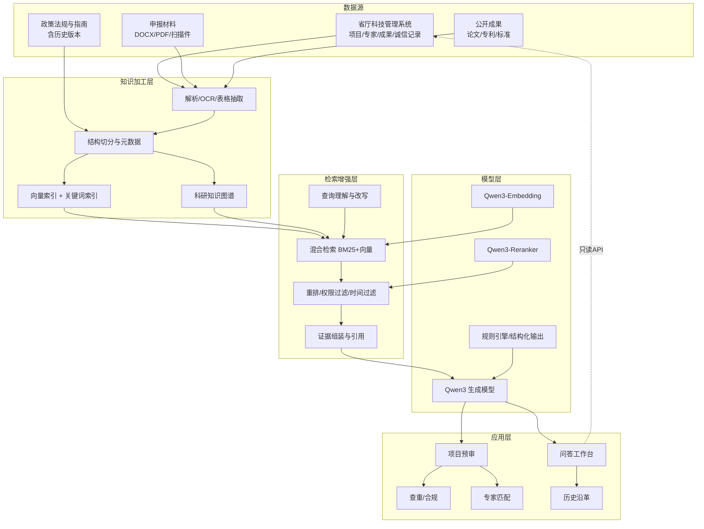

# 科研诚信 RAG 垂类模型与智能问答系统实施方案（V0.2）

**课题**：科研诚信驱动的自然资源科研全周期智慧治理与大模型协同关键技术研究  
**定位**：江苏省自然资源科技管理系统的外挂式 AI 评审助手  
**版本**：V0.2（首期原型已落地；历史沿革按“多年论文趋势分析”实现）  
**日期**：2026-10-23

---

## 0. 摘要

用“Qwen 基座 + 领域 RAG + 轻量微调 + 规则引擎”构建一个**不侵入现有科技管理系统**的 AI 助手：管理人员和评审专家在现有系统内（或独立工作台）上传/调取申报书，获得带原文引用的形式审查、合规审查、语义查重、诚信风险提示、专家匹配建议和评审问题清单。

三条硬边界：

1. **不替代**专家评审和行政审批，不自动给出立项结论、不自动打分排名、不自动处罚；
2. **不重建**现有系统，不写业务库，AI 侧只读数据、独立部署；
3. **不出内网**，评审材料不用于模型训练（除非书面授权）。

首期原型已完成：文档上传、带引用问答、项目预审、多年文献趋势、千问/离线双模式均已在本机跑通；3 个月完成“项目预审”试点闭环的目标不变。运行方式见 `README.md`。

**首期已落地范围**

| 能力 | 状态 | 说明 |
|---|---|---|
| 文档上传与解析 | 已实现 | DOCX/PDF/TXT/MD；按章节/段落切分；页码/章节引用 |
| RAG 问答 | 已实现 | 当前为字符 n-gram TF-IDF 检索；千问可切换；离线可演示 |
| 项目预审 | 已实现 | 形式完整性、诚信与规范、语义查重、政策合规提示；不评分 |
| 历史沿革 | 已实现 | 多年论文趋势：任意主题、年度发文量、主题热度、趋势研判 |
| 3D 趋势视图 | 已实现 | ECharts GL 3D 柱状图/主题矩阵、旋转暂停/继续、离屏与后台停动、2D 切换 |
| 登录与品牌 | 已实现 | 地形等高线动态背景（描边/视差/扫描带/纸纹）、能力卡与四角色演示卡、纯 SVG+CSS 且支持减少动态效果 |
| 工作台入口 | 已实现 | 登录成功短暂过渡后落 `/welcome`：按时段问候、按权限过滤的能力入口与边界声明；侧栏品牌可随时返回 |
| 界面主题 | 已实现 | 顶栏切换青绿纸色、黑白、蓝白和极光紫；蓝白与黑白主题在展开和收起状态下都使用白色侧栏，其中蓝白使用深蓝导航与浅蓝活动态，黑白使用石墨导航与浅灰活动态；只有顶部 logo/品牌带保留主题深色，折叠按钮与 logo 共用中线。系统栏和品牌区保留主题渐变；数据表使用主题中性浅色表头。状态色、图表类别与内容预览保留原色；主题旁简约开关关闭全部动画、过渡和装饰图标，浏览器本地保存，风险和错误提示保留语义色 |
| 无障碍与响应式 | 已实现 | skip link、路由焦点移交、抽屉焦点陷阱、图表 `role="img"` 摘要、辅助文字对比度实测过 AA；宽度 8 档 + 高度 3 档断点，375px 无横向溢出 |
| 统一动效 | 已实现 | 路由过渡、导航滑块、消息/证据入场、KPI 数值滚动与更新闪光、图表数据过渡、预审步骤/风险环、表格行增删退出、匹配空↔结果切换、上传完成对勾、Toast；支持减少动态效果 |
| 查重+专家匹配一体化工具 | 已实现（原型） | 专家库/CSV 导入/回避与负载过滤/可解释匹配；与段落查重合并为 `/match` 页面和 `/api/tool/check` |
| 文献数据 | 已实现 | CSV 导入；42 篇合成演示文献可移除 |
| 千问接入 | 已实现 | DashScope / 内网 OpenAI 兼容服务；已用 mock 验证四条链路 |
| 外挂集成 | 待联调 | 需现有系统提供只读接口/视图、SSO；首期先用独立工作台 |

---

## 1. 项目理解

### 1.1 现状与痛点

现有江苏省自然资源科技管理系统已实现科技项目、科研课题、专家管理的流程线上化，但智能化能力缺失：

| 环节 | 现状 | 痛点 |
|---|---|---|
| 形式审查 | 人工逐项核对 | 耗时、漏检、标准不一致 |
| 查重 | 字符级比对 | 改写、洗稿、跨语言、跨年度重复识别不了 |
| 合规审查 | 靠人记政策 | 条款多、版本多、申报时点适用版本易错 |
| 专家匹配 | 人工遴选 | 主观、回避关系难查全、负载不均 |
| 评审辅助 | 专家独立阅读 | 本子长、时间短、意见质量参差 |
| 诚信风控 | 事后处理 | 重复申报、成果重复使用、历史失信发现滞后 |
| 历史沿革 | 论文分散、靠人工综述 | 多年主题热度、阶段变化、研究空白难以快速判断 |

### 1.2 建设目标

**业务目标**

- 单本预审时间降低 50% 以上；
- 形式审查硬性项漏检率低于 5%；
- 查重结果可解释、可复核，误报率可控；
- 专家匹配满足回避约束，排序可解释；
- 每条 AI 结论都能回到原文页码/条款。

**技术目标**

- 政策问答按“申报时点”自动匹配有效版本；
- 支持 DOCX/PDF/扫描件上传、解析、问答、对比；
- 评审材料全流程内网闭环，权限到文档、到项目；
- 关键输出结构化（JSON），可被现有系统调用和回写。

### 1.3 边界（首期不做）

- 不做全周期成果转化和跨省数据汇聚；
- 不做互联网公开服务；
- 不做“AI 直接定立项/定评分”；
- 不做通用聊天机器人，只做科研管理与评审垂直场景。

### 1.4 与课题考核指标映射

| 课题研究内容/考核指标 | 本方案对应模块 |
|---|---|
| 研究内容 1：全周期治理框架与诚信评价体系 | 诚信风险指标库、分级规则、评审检查清单 |
| 研究内容 2：智能受理、语义查重、合规审查、专家匹配 | 项目预审六步流程、查重引擎、合规引擎、专家匹配 |
| 研究内容 3：科研知识图谱与 RAG 知识引擎 | 文档中心、混合检索、知识图谱、时间感知 RAG |
| 研究内容 4：风险预警、辅助评审、成果转化 Agent | 评审辅助报告、诚信风险提示、专家匹配解释 |
| 研究内容 5：治理模式与技术路径凝练 | 制度规则数字化、试点报告、推广方案 |
| 考核指标：智能查重、专家匹配一体化工具 + 软著 | 本方案的应用层工具与接口 |
| 考核指标：试点验证报告、论文、研究报告 | 第 8、9 章的试点与评测设计 |

---

## 2. 总体思路

### 2.1 一句话方案

**一个底座、两条知识线、三类助手、双向外挂。**

- **一个底座**：Qwen 生成模型 + 向量/关键词混合检索 + 规则引擎 + 文档中心。
- **两条知识线**：
  - 论文趋势线（首期）：多年文献的主题、年份、关键词、摘要，支撑任意主题趋势分析；
  - 治理沿革线（扩展）：政策版本/生效时间 + 项目—人员—机构—成果—评审谱系。
- **三类助手**：问答助手、预审助手、匹配助手。
- **双向外挂**：
  - **模型进系统**：AI 以侧边栏/独立工作台嵌入现有系统，入口不改核心流程；
  - **系统能力工具化**：模型通过只读 API 查项目、查专家、查成果、查历史，把现有系统当作“工具库”。

### 2.2 设计原则

1. **外挂不侵入**：优先 iframe/微前端、API、只读视图，不改原系统业务代码。
2. **证据可追溯**：所有结论带原文引用；无依据时明确说“资料不足”。
3. **人机协同**：AI 做检查、找证据、提问题；人做判断、签字、定结论。
4. **能用规则不用模型**：页数、预算上限、资格、格式等确定性校验走规则引擎，LLM 只做解释和兜底。
5. **能用工作流不用自治 Agent**：评审流程用确定性工作流编排；Agent 只用于开放式问答和探索。
6. **先跑通再优化**：先做“上传式离线版”，再谈系统接口和自动化。
7. **评测驱动**：先建黄金评测集，再调模型和阈值。

### 2.3 总体架构



---

## 3. 核心业务：AI 专家评本子

### 3.1 角色与入口

| 角色 | 入口 | 主要能力 |
|---|---|---|
| 科研管理人员 | 现有系统侧边栏 / 独立工作台 | 批量预审、形式/合规检查、查重、分派 |
| 评审专家 | 评审任务页侧边栏 | 单本辅助阅读、相似项目、问题清单、意见草稿 |
| 申报人（可选） | 独立入口 | 申报自检、政策问答（不能看他人材料） |
| 领导（可选） | 统计页 | 批次风险分布、评审进度、专家负载 |

### 3.2 “评本子”六步流程


| 步骤 | 输入 | 处理 | 输出 | 人工确认 |
|---|---|---|---|---|
| 0 建任务 | 本子文件/项目ID、指南、学科、申报人 | 解析正文、表格、附件；建立任务 | 结构化本子、章节索引 | 解析失败人工重传 |
| 1 形式审查 | 本子结构、指南要求 | 规则校验：完整性、资格、页数、预算算术、签字盖章、附件 | 通过/存疑/不通过清单 | 必看 |
| 2 合规审查 | 本子内容、政策库 | 按申报时点检索有效条款，逐条比对 | 条款级“符合/存疑/不符合”+引用 | 存疑项必看 |
| 3 语义查重 | 本子段落、历史本子/成果库 | 段落级向量比对+重排；引用/抄袭区分 | 相似段落对、相似度、并排证据 | 必看 |
| 4 诚信风险 | 申报人/团队历史、项目谱系 | 重复申报、成果重复使用、异常署名、回避关系、历史失信 | 风险等级+证据链 | 必看 |
| 5 评审辅助报告 | 以上结果 | 汇总为结构化报告，生成评审问题清单 | Word/PDF 报告、JSON | 专家可编辑 |
| 6 专家匹配 | 本子主题、专家画像、回避/负载 | 硬约束过滤+语义匹配+可解释排序 | 候选专家列表+理由 | 管理人员确认 |

> **关键设计**：AI 不输出“总分”和“立项建议”。它输出的是**检查清单、证据、风险提示、给专家的提问**。如课题研究需要评分模型，单独作为实验模块，且不得作为评审唯一依据。

### 3.3 结构化的预审报告

统一 JSON Schema，前端渲染、后端可被现有系统调用：

```json
{
  "task_id": "RV-2026-0001",
  "project": {"id": "...", "title": "...", "applicant": "...", "discipline": "..."},
  "summary": "本子整体完整，研究内容与指南方向一致；存在 2 项需补充说明。",
  "dimensions": [
    {
      "name": "形式审查",
      "status": "warn",
      "findings": [
        {
          "issue": "预算设备费与任务书测算不一致",
          "severity": "medium",
          "evidence": "预算表第 3 页；研究内容第 5 页",
          "clause": "《XX项目管理办法》第 X 条",
          "suggestion": "请申报人补充设备费测算依据"
        }
      ]
    }
  ],
  "duplicate": {
    "max_similarity": 0.87,
    "matches": [
      {"source": "2023 年立项项目 A", "section": "研究内容", "similarity": 0.87, "evidence": "..."}
    ]
  },
  "integrity_risks": [
    {"type": "重复申报", "level": "high", "evidence": "同一负责人 2025 年已立项相近题目"}
  ],
  "questions_for_reviewers": [
    "本子所述数据来源与省厅已有数据底图如何衔接？",
    "创新点与 2023 年项目 A 的差异是否需要进一步说明？"
  ],
  "disclaimer": "本报告为 AI 辅助意见，不构成立项结论，须经专家和管理人员复核。"
}
```

### 3.4 “历史沿革”：多年论文趋势分析

按需求确认，“历史沿革”指**基于多年论文的任意主题趋势分析**，不是单纯的政策/项目谱系。首期已实现：

**输入**

- 用户输入任意主题，例如“科研诚信”“大模型”“语义查重”“专家评审”“成果转化”；
- 也可输入自然语言问题，如“近五年大模型在科研诚信中的应用趋势”；
- 年份范围可选。

**处理**

1. 在文献库中按标题、关键词、摘要做相关性筛选（术语命中 + 字面相似度）；
2. 按年份统计年度发文量；
3. 按年份统计主题词出现次数，形成主题热度曲线；
4. 计算年度高频主题、代表文献、首末年变化；
5. 可选调用千问，基于统计数据和代表文献生成 3–5 条趋势研判；未配置模型时用规则摘要；
6. 标注“演示数据/真实数据”，避免把合成数据当作真实结论。

**输出**

- 年度发文量柱状图；
- 主题热度折线图（可切换主题）；
- 年度高频主题卡片；
- 代表性文献列表；
- 趋势研判（上升/下降/稳定、阶段变化、研究空白、后续跟踪建议）。

**数据接入**

- 文献 CSV：标题、年份、作者、期刊、摘要、关键词；
- 上传 PDF/DOCX 并选择“文献”类型，也会进入文献库；
- 首期内置 42 篇合成演示文献，可一键移除。

**扩展（后续）**

- 政策版本沿革：在政策元数据中加 `生效/失效日期、版本、修订关系`，按申报时点检索有效版本；
- 项目/成果谱系：用图谱查重复立项、成果重复使用、专家回避链；
- 这两项作为“历史沿革”的扩展，不替代首期的论文趋势分析。

### 3.5 专家匹配（首期已实现原型）

专家匹配不是纯生成任务，采用“**硬约束 + 语义匹配 + 可解释排序**”；首期已落地专家库、CSV 导入、回避/负载过滤、匹配理由和一体化页面：

1. **硬约束**：学科方向、职称/资格、单位回避、亲属/师生/合作回避、在研项目冲突、评审负载、评审期可用性；
2. **语义匹配**：本子研究内容与技术路线向量 vs 专家成果/方向向量；
3. **行为校准**：历史评审质量、专业覆盖度、评审完成率（仅用工作相关数据）；
4. **多样性与公平性**：单位/地区/年龄结构适度分散，不使用性别、民族等敏感属性；
5. **可解释**：每个推荐给出“匹配理由 + 回避检查结果 + 负载情况”，管理人员可调整；
6. **留痕**：推荐、调整、最终抽取全过程审计。

> 首期实现：专家字段不包含性别/年龄；按“不可评审、在研≥5、同单位、回避单位/人员”过滤；匹配分=方向语义+关键词+学科，并输出相对匹配度和理由。示例专家为合成数据，真实专家库需授权导入。

---

## 4. 数据工程

### 4.1 数据源

| 数据源 | 内容 | 获取方式 | 更新 | 密级 |
|---|---|---|---|---|
| 省厅科技管理系统 | 项目/课题、申报书、评审任务、专家、成果、诚信记录、指南/批次 | 只读 API / 数据库只读视图 / 文件导出 | 每日增量+事件触发 | 内部/敏感 |
| 申报材料 | 申请书、预算书、附件、证明材料 | 上传/系统拉取 | 实时 | 评审机密 |
| 政策法规 | 国家/省/厅科研诚信、项目管理、评审规则、行业标准 | 人工采集+定期更新 | 月度 | 公开/内部 |
| 公开成果 | 论文、专利、标准、软著 | 公开数据库/人工导入 | 季度 | 公开 |
| 机构与人员 | 单位、部门、人员主数据 | 系统同步 | 每日 | 内部 |

### 4.2 解析与切分

- **DOCX**：保留标题层级、表格、页眉页脚；按章节建树；
- **PDF**：版面分析（MinerU/PP-Structure），表格转 Markdown，公式/图注单独处理；
- **扫描件**：PaddleOCR，输出质量分；低质量件提示人工复核；
- **切分策略**：
  - 政策：按“章—条—款”原子切分，保留条款上下文；
  - 本子：父块=章节（如“研究内容”），子块=段落（400–800 字，10%–15% 重叠）；
  - 表格：整表保留，附列名和表注；
  - 每个块前置“文档标题 > 章节 > 小节”上下文头，提升检索命中率。
- **元数据**：`doc_id, doc_type, title, issuer, doc_no, publish_date, valid_from, valid_to, version, supersedes, confidentiality, project_id, applicant_id, section_path, page, acl`。

### 4.3 权限与隔离

- 文档级 ACL + 项目级 ACL + 角色 ACL，检索时过滤，不能靠前端隐藏；
- 评审期材料默认仅评审组和管理员可见；
- 专家只能看分派给自己的本子；
- 申报人只能看自己的材料；
- 日志记录“谁、何时、问了什么、检索到哪些文档、生成了什么”；
- 日志中的个人信息脱敏，原文另行加密存储。

### 4.4 知识图谱

- **首期不追求大而全**：先做项目—人员—机构—成果—政策五类实体，覆盖查重、回避、谱系三个高价值查询；
- **构建方式**：规则抽取（项目编号、人员、单位、成果类型）+ LLM 抽取（技术方向、合作关系）+ 人工校验；
- **实体消歧**：人员重名、机构改名、项目别名，建立主数据映射；
- **存储**：试点用 Neo4j Community 或 PostgreSQL 关系表；规模上来再换 NebulaGraph；
- **用法**：图谱负责“关系型问题”，向量检索负责“语义型问题”，二者结果在编排层融合，不强行把一切都 GraphRAG。

### 4.5 数据质量

- 主数据对齐：人员、机构、项目编号统一；
- 申报书解析质量评分：文本完整率、表格识别率、OCR 置信度；
- 低质量文档进入人工复核队列；
- 政策版本人工校验，避免“现行有效”标错；
- 历史本子入库前做脱敏和授权审查。

---

## 5. RAG 与模型

### 5.1 模型选型

| 用途 | 建议 | 理由 |
|---|---|---|
| 生成 | Qwen3-32B-Instruct（AWQ/FP8）或 Qwen3-30B-A3B | 32B 质量稳，30B-A3B 吞吐高；私有化部署 |
| 向量 | bge-m3（已接入）/ Qwen3-Embedding-4B（可选） | 中文语义强、支持长文本；bge-m3 现成可用，Qwen3 待本地化评估 |
| 重排 | Qwen3-Reranker-4B（或 0.6B） | 提升条款/段落级精度 |
| 解析 | MinerU + PaddleOCR + python-docx | 覆盖 PDF/扫描件/DOCX/表格 |
| 服务 | vLLM / SGLang | 高吞吐、OpenAI 兼容接口 |
| 编排 | FastAPI + LangGraph（或轻量自研状态机） | 评审流程需要确定性编排和结构化输出 |
| 向量库 | Milvus 2.5+（稠密+BM25 混合）｜**当前量级暂不引入** | 少组件、支持元数据过滤；几千块用内存点积更快 |
| 图谱 | Neo4j / PostgreSQL（试点） | 关系查询与谱系 |
| 前端 | React 19 + TypeScript + Vite + ECharts / ECharts GL + Framer Motion | 组件化、3D 趋势图、生态成熟 |

> **“垂类模型”不是从零预训练**。性价比最高的路径是：通用 Qwen 基座 + 领域 RAG + 规则引擎 + 少量 LoRA 微调。预训练/继续预训练成本高、收益不确定，不建议在 13 万课题里做。

### 5.2 检索链路

1. **查询理解**：意图分类（政策问答/本子审查/查重/专家匹配/沿革查询）、抽取项目/学科/时间等槽位；
2. **查询改写**：多查询扩展、术语归一（自然资源行业词表）、必要时 HyDE；
3. **混合检索**：BM25 + 稠密向量，元数据过滤（文档类型、密级、项目、生效日期）；
4. **重排**：Cross-Encoder 重排 Top 50 → Top 8；
5. **证据组装**：父块回填、去重、按条款/章节排序、保留页码；
6. **生成**：严格基于证据，输出“结论 + 引用 + 不确定性”；
7. **引用校验**：生成后校验每个引用是否真实存在、是否支持该结论；不通过则降级为“资料不足”。

> **首期实现说明**：原型用 FastAPI + 轻量编排 + 字符 n-gram TF-IDF 检索（现已叠加向量后端，TF-IDF 保留为基线），前端为 React 19 + Vite + ECharts GL（3D 柱状图/主题矩阵 + 2D 切换），保证在无 GPU、无外部向量库的环境也能跑通；检索层已做接口隔离，后续替换为 Qwen3-Embedding + Milvus + Reranker 不影响前端和业务 API。

### 5.3 生成与结构化

- 问答：流式输出，句级引用，支持多轮；
- 预审：按审查维度分别检索、分别生成，避免一个超长 Prompt 丢信息；
- 长本子：章节级 Map-Reduce，再做跨章节一致性检查（研究内容 vs 预期成果 vs 预算 vs 进度）；
- 结构化：JSON Schema 约束 + Pydantic 校验 + 失败重试；
- 拒答：证据不足、权限不足、问题超出范围时明确说明，不编造；
- 输出标识：报告页脚标注“AI 辅助生成，须人工复核”。

### 5.4 微调策略

- **先不微调**：用 Prompt + RAG + 结构化输出跑基线，测出瓶颈再决定；
- **需要微调的典型场景**：报告格式不稳定、术语不规范、合规判断口径不一致、引用习惯差；
- **数据**：500–2000 条高质量样本（评审报告、条款判断、问题清单、拒答案例），由业务专家审核；
- **方法**：LoRA/QLoRA，8B/14B 也可作为“任务小模型”承担格式化和初筛，32B 负责复杂生成；
- **评测**：微调前后在同一黄金集上对比忠实度、引用准确率、人工采纳率，不只看 loss。

### 5.5 幻觉与提示注入防护

- 上传文档视为**不可信数据**：文档里的“请忽略以上指令”一律不执行；
- 系统提示与文档内容隔离，工具调用白名单，禁止文档触发写操作；
- 检索前做 ACL 过滤，防止越权检索；
- 输出做 Schema 校验、敏感信息检测、引用存在性校验；
- 高风险结论（查重、失信）必须展示证据并强制人工复核；
- 红队测试：越权、注入、诱导泄露、跨项目串数据。

---

## 6. 系统与界面

### 6.1 模块清单

| 模块 | 功能 |
|---|---|
| 文档中心 | 上传、解析、预览、版本、权限、删除 |
| 知识库 | 政策库、历史本子库、成果库、专家库、术语库 |
| 问答工作台 | 多轮问答、文档问答、引用溯源、对比 |
| 预审任务 | 建任务、六步审查、报告生成、导出 |
| 查重 | 段落比对、相似度、并排证据、复核标记 |
| 合规 | 条款检索、逐条判断、版本说明 |
| 专家匹配 | 候选生成、回避检查、负载、解释、导出 |
| 历史沿革 | 多年文献趋势、主题热度、年度高频主题；政策时间轴/项目谱系为扩展 |
| 系统管理 | 用户/角色/权限、模型配置、审计日志、评测集 |

### 6.2 问答界面

三栏布局：

```
┌──────────────┬────────────────────────────┬─────────────────┐
│ 知识库/文档   │  对话 / 审查任务            │ 证据与引用       │
│              │                            │                 │
│ - 政策库      │  [上传本子] [选择模式]       │ 条款原文/页码    │
│ - 历史本子    │                            │ 相似段落对比     │
│ - 我的任务    │  ...流式回答...             │ 风险提示         │
│ - 最近对话    │  [引用1] [引用2]            │ 置信度/版本      │
│              │  [导出报告] [反馈]           │                 │
└──────────────┴────────────────────────────┴─────────────────┘
```

关键交互：

- **上传**：拖拽 PDF/DOCX/TXT/XLSX/图片；显示解析进度、OCR 质量、失败原因；支持重新解析；
- **模式**：政策问答 / 项目预审 / 查重 / 合规 / 专家匹配 / 多文档对比 / 历史沿革；
- **趋势视图**：3D 柱状图/主题矩阵与 2D 折线/柱状图一键切换，3D 支持拖拽旋转与缩放；
- **招牌动效**：工作台首访纸页展卷、问答引用循证与原文强调、真实预审结果呈卷及“待人工复核”落款，适配手机与减少动态效果；
- **动效**：正文归位 280ms/退出不淡出、按钮反馈 150ms、数字更新 480ms；3D 支持旋转暂停/继续与离屏/后台停动，2D Canvas 动态响应减少动态效果；页面过渡、导航滑块、消息与证据入场、KPI 数字/字符串切换、图表数据过渡、摘要/年度主题/文献联动、预审步骤与风险环、上传/Toast；遵循 `prefers-reduced-motion`；
- **引用**：点击引用跳到 PDF 页码并高亮；条款显示版本和生效日期；
- **对比**：两版本子并排，差异高亮；政策新旧版本 diff；
- **报告**：在线编辑、导出 Word/PDF、带水印和免责声明；
- **反馈**：赞/踩/纠错，进入评测集闭环；
- **权限**：不同角色看到不同知识库和任务。

### 6.3 API 设计（示例）

| 方法 | 路径 | 说明 |
|---|---|---|
| POST | `/api/v1/documents` | 上传文档 |
| GET | `/api/v1/documents/{id}/status` | 解析状态 |
| POST | `/api/v1/qa` | 问答（SSE 流式） |
| POST | `/api/v1/reviews` | 创建预审任务 |
| POST | `/api/v1/reviews/{id}/run` | 执行指定审查步骤 |
| GET | `/api/v1/reviews/{id}` | 获取结构化报告 |
| POST | `/api/v1/duplicate/check` | 查重 |
| POST | `/api/v1/compliance/check` | 合规检查 |
| POST | `/api/v1/experts/match` | 专家匹配 |
| GET | `/api/v1/policies/timeline` | 政策时间轴 |
| GET | `/api/v1/projects/{id}/lineage` | 项目谱系 |
| GET | `/api/v1/audit/logs` | 审计日志 |

### 6.4 技术栈

- 前端：React 19 + TypeScript + Vite + React Router + ECharts / ECharts GL + Framer Motion（统一动效）+ Lucide；
- 后端：Python 3.11 + FastAPI + Uvicorn + Pydantic；原型用 SQLite，生产可换 PostgreSQL；
- 异步：Celery/RQ + Redis；
- 存储：PostgreSQL（业务元数据）+ MinIO（文件）+ Milvus（向量/全文）；
- 模型：vLLM + Qwen3 + Embedding + Reranker；
- 解析：MinerU + PaddleOCR + python-docx + LibreOffice（格式转换）；
- 部署：Docker Compose（试点）→ Kubernetes（推广）；Nginx；内网；
- 监控：Prometheus + Grafana + Loki；
- 安全：OIDC/CAS 单点登录、RBAC/ABAC、TLS、审计日志、病毒扫描。

### 6.5 部署与算力

- **优先私有化内网部署**，评审材料不出域；
- 前端 React 构建产物（`frontend/dist`）由 Nginx 或 FastAPI 托管；开发期用 Vite 代理 `/api`；
- 后端 Uvicorn/Gunicorn 多 worker；SSE 需要关闭 Nginx 缓冲（`X-Accel-Buffering: no`）；
- 3D 图表在浏览器端渲染，依赖 WebGL；无 WebGL 自动降级 2D，不影响业务；
- 3D 图表关闭滚轮缩放，滚轮用于页面滚动；保留拖拽旋转；
- 页面固定滚动条槽，避免顶栏操作按钮因滚动条出现/消失而左右偏移；
- 动效遵循 `prefers-reduced-motion`；3D 自动旋转支持手动暂停/继续，拖拽结束静置 4s 后恢复，离屏与后台暂停；
- 前端按路由做 code splitting：问答首屏约 423KB，3D 趋势页（ECharts GL）按需加载约 1.66MB；
- 1×48GB 显存可跑 32B 4-bit 量化，适合试点；并发高时用 30B-A3B MoE 或加卡；
- 只有 24GB 显存时选 14B/8B 量化，或先把 Embedding/Reranker 放 CPU/小卡；
- 无 GPU 且允许上政务云 MaaS 时，选支持数据不出域的专属实例；否则不建议用公网 API 处理评审材料；
- 信创适配（麒麟/统信、达梦/金仓、昇腾）作为可选项，按厅里要求单列适配工作。

---

## 7. 与省厅系统“外挂”集成

### 7.1 先做系统盘点（P0 阶段）

需要原系统厂商配合提供：

- 技术栈、数据库类型/版本、部署位置、等保级别；
- 是否有 API 网关/WebService/数据库只读从库；
- 统一身份认证方式（CAS/OAuth2/OIDC/门户 Token）；
- 文件存储位置与访问方式；
- 项目/课题/评审/专家/成果/诚信记录的数据字典；
- 评审流程状态机、专家抽取规则、回避规则、权限模型；
- 日志与审计要求。

**产出**：《现有系统对接说明书》《数据字典映射表》《接口清单》《权限矩阵》。

### 7.2 三种外挂方式

| 方式 | 做法 | 侵入性 | 适用 |
|---|---|---|---|
| A 入口外挂 | 现有系统加菜单/侧边栏，iframe/微前端嵌入 AI 工作台；SSO Token 透传；postMessage 传项目 ID | 低 | 首期首选 |
| B 服务外挂 | 现有系统在形式审查/专家抽取节点调用 AI API，异步任务+回调，结果作为“参考意见” | 中 | 预审闭环 |
| C 数据外挂 | 只读账号/只读视图/增量 API/文件摆渡，把数据同步到 AI 侧；不写回业务库 | 中 | 知识库与谱系 |

**推荐顺序**：A → B → C。A 最快出效果；B 体现“嵌入流程”；C 决定知识库上限。

**如果原厂商短期不配合**：先做独立工作台 + 上传文件 + 导出报告，业务价值仍然成立；接口后置。

### 7.3 数据抽取清单

| 对象 | 关键字段 | 用途 |
|---|---|---|
| 项目/课题 | 项目编号、名称、批次、负责人、单位、学科、金额、状态、起止时间 | 谱系、查重、统计 |
| 申报书 | 项目 ID、文件、版本、提交时间 | 预审、查重 |
| 评审任务 | 任务 ID、项目、专家、轮次、状态 | 评审辅助 |
| 专家 | 姓名、单位、学科、职称、成果、回避关系、负载 | 专家匹配 |
| 成果 | 类型、名称、完成人、项目、时间、佐证 | 查重、谱系、转化 |
| 诚信记录 | 对象、类型、处理结果、时间、依据 | 风险提示 |
| 指南/批次 | 方向、条件、预算上限、时间 | 合规审查 |

### 7.4 单点登录、权限与审计

- SSO：优先复用厅统一门户 Token；AI 侧只做身份校验和角色映射，不另建账号体系；
- 权限：以现有系统的项目成员/评审组为准，AI 侧同步 ACL；
- 审计：AI 侧记录完整访问日志；关键操作（导出报告、查看诚信记录）双日志；
- 回写：只回写“AI 参考意见/报告链接”，不覆盖专家意见和审批结论；
- 接口安全：服务间签名、时间戳、幂等键、限流、白名单。

---

## 8. 实施计划

### 8.1 阶段与里程碑

| 阶段 | 周期 | 关键工作 | 交付物 |
|---|---|---|---|
| P0 准备 | 2 周 | 需求确认、数据授权、系统盘点、评测集设计、环境准备 | 需求规格、对接说明、评测集 v0 |
| P1 底座与问答 MVP | 4 周 | 文档解析、索引、混合检索、问答、上传、引用 | 可演示 MVP |
| P2 项目预审闭环 | 6 周 | 形式/合规/查重、结构化报告、导出、A 方式集成 | 预审工具 v1、10–20 本实测 |
| P3 专家匹配与诚信风险 | 6 周 | 专家画像、约束匹配、风险规则、项目谱系 | 匹配工具 v1、风险清单 |
| P4 集成试点 | 6 周 | B/C 方式接口、SSO、试点处室、评测 | 试点报告、评测报告 |
| P5 验收推广 | 4 周 | 优化、安全测试、培训、软著/论文/研究报告 | 验收材料、推广方案 |

总计约 28 周；可按课题 12 个月周期拉长，预留数据授权和接口协调的 buffer。

### 8.2 首期原型（已落地）与下一轮 4 周

- 单页工作区：所有受保护路由共享卷宗上下文和文档中心验证过的紧凑外壳，只有当前工作面切换；侧栏与顶栏标题由同一工作区配置驱动，避免顺序与权限漂移，中央功能导航已移除以释放工作面空间；旧路由保留刷新、深链与浏览器后退语义。统一 `WorkDeck` 为卷宗、预审、匹配、趋势和用户管理提供固定章节舞台、方向切换与键盘操作；工作台改为纯总览，问答、图谱与文档中心使用固定分栏或窄屏分区。顶部统一选择课题卷宗或单独申报书，缺少当前申请书时不沿用其他文档，预审、匹配同步当前本子，问答支持独立选择范围，桌面预审结果完整打印，手机任务态压缩上下文并切换问答与证据，文档可筛选，专家库与代表性文献按需展开。权限和人工复核边界不变。
- 课题卷宗材料层：新增 `dossiers` 与 `dossier_documents`，把申请书、盖章件、诚信承诺书、合同/实施承诺、验收材料归入同一课题；同角色新材料自动形成新版本并成为当前版本。材料体检按指令性/指导性和申报/实施/验收/结题阶段检查，区分“缺项、待人工确认、已具备”，并明确不验证公章/签字真实性、不代表官方流程状态。卷宗归档与材料体检位于独立 `/dossiers` 工作面，采用左侧七步编号栏与右侧固定页面，列表在页内翻项，桌面、80%–200% 等效视口和手机均不产生整页纵向滚动；无卷宗时预审继续兼容单文档选择。

- 知识图谱与文档中心：图谱采用三栏语义工作台，默认从全库或指定卷宗本地文本提取最多 500 个关键词（默认 100，包含卷宗历史版本）、以分块共现余弦连线、自动聚类并展示原文来源；另保留人工图谱 48 个实体、100 条关系、7 个知识域，支持知识域显隐、搜索、邻接、最短路径和深链；文档中心采用课题材料、公共与参考资料两级目录和开卷正文；卷宗关联角色用于课题细分类，同一文档不同角色可多处显示、同角色去重，未归类资料保留入口。读取接口返回有序文本块且不暴露本地路径，保留上传、删除、筛选、问答、预审和文献 CSV 管理。

- 问答入口可逐次选择模型与支持的推理强度；后台校验供应商密钥、出口授权和可用能力，生成中锁定，回答附实际来源和强度，预审及趋势不受影响。

- 模型来源可核对：顶栏与手机标题区显示当前供应商/模型，问答和预审分别保存实际来源，Markdown 报告同步导出。兼容千问旧接口，离线回退不冒认已配置模型，流中断保留真实来源并提示中断；受控回归覆盖 DeepSeek、千问与离线回退，不请求外部模型。

本轮补强：模型预审保留系统政策引用、可展开原文和真实查重；OpenAI 默认不发其他供应商扩展参数，显式思考方言优先于预设；嵌入重定向测试检查实际禁跳参数，环境变量清单包含预设间接密钥；手动政策抓取仅 HTTPS、校验证书并拒绝重定向，历史政策不因从清单移除而自动删除。

2026-10-27 修正：LLM/嵌入共用门禁拒绝编码主机名及非标准数字 IP，DeepSeek 不再借用千问密钥；政策只参与问答和合规引用、不进入查重候选；本地清单默认限定 corpus/ 且强制 SHA256；条号按归一正文定位，旧政策仅在快照一致时原位修正章节、保留引用 ID 与正文。

**已落地**

- 文档上传、解析、分块、检索、带引用问答（DOCX/PDF/TXT/MD）；删除文档会级联清理索引分块、关联文献记录与上传原件；
- 演示数据自动种子：首次启动写入 10 份虚构演示本子（`rag/demo_proposals.py`，source='demo'，内置相似段落/同单位回避/负载满等演示设计）、42 篇合成文献、12 位合成专家（均标记 `is_sample=1`）；真实申请书含个人信息，默认不入库（`SEED_SAMPLE_DOC=0`）；
- 项目预审：形式完整性、诚信与规范、语义查重、政策合规提示、报告导出；
- 公开政策语料（真实公文，非演示数据）：`corpus/` 存两部政府公开文件（科技部等22部门《科研失信行为调查处理规则》国科发监〔2022〕221号、江苏省科技厅《江苏省科技计划项目信用管理办法》苏科技规〔2022〕3号）；`tools/fetch_corpus.py` 负责抓取与公文排版还原并生成 `corpus/sources.json` 溯源清单（URL/许可/抓取时间/原始 sha256/文本 sha256），`python3 -m rag.corpus` 离线导入（`kind='policy'`、`source='public'`，幂等，`--force` 重建）；预审「政策合规」由“政策库未接入”升级为按「文件＋章＋条」引用真实条款，仍只给提示、版本时效需人工核对；
- 历史沿革：任意主题多年文献趋势（年度发文量、主题热度、年度高频主题、代表文献、趋势研判）；
- 文献 CSV 导入、演示文献/演示专家一键移除；
- 千问/内网 OpenAI 兼容服务切换；未配置时离线检索式回答；
- React 19 + Vite 前端；ECharts GL 3D 年度柱状图/主题矩阵，支持 2D 切换与 WebGL 降级；Playwright 桌面视口验证通过；
- 查重+专家匹配一体化工具：`/match` 页面、专家 CSV 导入、回避/负载约束、可解释推荐、合并导出；同单位与配置回避单位采用保守排版归一（空白/全半角/括号），保留原名与命中依据。缺申报单位/负责人在页面独立提示，不推断简称、别名或上下级关系。
- 外部数据接入预留：`/api/ingest/experts|papers` JSON 推送（幂等去重）+ `/api/ingest/schema` 自描述契约；项目/诚信记录/政策版本结构已冻结（`rag/schemas.py`），接收端点待真实数据源就绪后启用；`INGEST_TOKEN` 可选鉴权。
- 登录与角色（原型）：账号密码（PBKDF2 加盐哈希）+ SQLite 会话 + HttpOnly Cookie；admin/manager/reviewer/viewer 四角色，后端中间件统一拦截、写操作按角色 403，前端按角色隐藏操作；`/admin` 用户管理；生产替换 SSO 时沿用角色模型。
- 安全加固（P0/P1 审查）：真实申请书默认不入库；演示账号仅本机监听创建 + 自助改密；3D tooltip XSS 转义；DOCX 解压总量上限；回避约束未识别申报人时明确告警；SSE 流式生命周期与结果串档治理；中文输入法回车防误发。
- 安全加固（P2 审查）：**公网 LLM 端点默认阻止**（`ALLOW_EXTERNAL_LLM` 显式授权，内网判定覆盖 CGNAT/保留网段）；登录失败限速（5 次/300 秒，429+Retry-After）；上传弹窗焦点陷阱与键盘可达。
- 安全加固（P3–P5 审查）：`/api/experts` 最小权限（viewer 不可读回避画像）；DOCX XML 实体声明直接拒绝；PDF 解析页数上限（`MAX_PDF_PAGES`，默认 2000）；`LLM_ENABLE_THINKING` 三态开关（Qwen3 兼容）；`COOKIE_SECURE` 会话加密传输；ASGI 真实权限矩阵回归（401/403/200）。
- 界面与文案：登录页动态地形背景（等高线描边/视差/扫描带/纸纹）；全局尺度与状态动效（表格行增删、匹配切换、KPI 闪光、上传完成）；全站文案统一为"勘验阅卷"意象，按钮/状态/免责声明保持直白。
- 检索升级（向量）：`rag/embeddings.py` 提供 local / api / none 三种后端，`auto` 按 本地 → API → 纯 TF-IDF 降级；向量接管 `search()`，TF-IDF 保留为基线与回落。公网嵌入端点受 `ALLOW_EXTERNAL_EMBED` 门禁（与 LLM 同口径）；向量按单条文本哈希缓存，新增文档不重算整库；后端不可用、行数不符、查询向量化失败三种情况均实测自动回落。`tools/eval_retrieval.py` 在 14 个政策问题上对比：命中@3 71.4%→92.9%、MRR 0.631→0.762。查重仍固定走 TF-IDF（字面重合才是查重口径）。暂不引入 Milvus：当前量级内存点积（37ms/次）已够，向量库要先起 etcd+MinIO，收益不抵运维成本。
- 路由交互：每次跨页或返回以绿色栏目卷标滑入提示页面就绪（延迟70ms、滑入350ms），不渲染背景box或纸影，标题立即可读、正文始终不透明；同页筛选与输入不重播，减少动态效果即时静态，手机端减幅并等待导航抽屉真实退场后再播放；右上角上传按钮在≤680px时统一44px图标形态。主题旁的简约模式全局关闭动画与装饰图标；查重匹配运行完成后停留当前页，不自动跳专家章节。
- 结果与上下文：预审结论首屏固定显示免责声明与能力边界并允许页内滚动；文档列表后台刷新不重置当前预审/查重结果；顶部卷宗切换同步问答范围并清空旧回答与证据；查看者不显示预审入口；材料人工确认改为显式按钮和确认对话框；所有横屏章节按钮保持至少44px触控高度。
- 趋势交互：分析设置内的快捷主题只刷新当前页主题与 KPI，不自动跳转；显式点击“分析趋势”才进入图表章节。
- 证据可达：趋势代表文献进入文档库文献数据并定位目标；问答引用、查重对方文档、预审政策/查重依据及卷宗材料名称直接打开对应文档正文。
- 浏览器持续回归：随仓库交付 76 项 Playwright 用例，覆盖角色权限、课题卷宗建立/归卷/人工确认、文档与 CSV、代表性文献到文档库的键盘/深链定位、流式问答及引用、预审/匹配报告下载、趋势与降级、简约模式目录重排、黑白主题彩色内容与蓝色表头、手机导航/焦点/动效和异常恢复；每例临时数据库、回环随机端口且关闭模型请求。GitHub Actions 随 push/PR 运行，失败保存截图、trace、录像与诊断。自动化已发现并修复空文献 3D 标签空值导致的页面崩溃；人工视觉审查继续保留。
- 文档与运行：`SECURITY.md`（威胁模型、权限矩阵、部署检查清单）；`run.sh` 自动探测 PYTHON / `.venv` / conda·Anaconda / 系统 python3；回归测试 151 个测试函数（参数化展开 164 项）。

**下一轮 4 周（建议）**

| 周 | 工作 | 验收 |
|---|---|---|
| W1 | 接入真实 Qwen（内网优先）；建 20–30 份政策、10–20 份真实本子评测集 | 千问可用、评测集 v1 |
| W2 | 用真实数据校准检索阈值、引用准确率、预审口径 | 政策问答 10 题 ≥8 题引用正确 |
| W3 | 本地化嵌入（bge-m3 落 `models/`，走 `EMBED_BACKEND=local`）+ 词面/向量混合检索 + Reranker；量级上到十万块再评估 Milvus | Recall@5、引用准确率达标 |
| W4 | 与现有系统做 A 方式（iframe/SSO）联调；试点演示 | 单本 5 分钟内出带引用报告 |

MVP 验收标准：上传一份本子，5 分钟内生成带原文引用的形式/合规检查报告；政策问答 10 题中至少 8 题引用正确。

### 8.3 团队与资源

| 角色 | 人数 | 职责 |
|---|---|---|
| 项目负责人/领域专家（厅方） | 1 | 业务口径、数据授权、试点协调 |
| 项目经理 | 1 | 计划、风险、对接 |
| 架构师 | 1（兼） | 总体架构、接口、安全 |
| 算法/RAG 工程师 | 2 | 解析、检索、生成、评测 |
| 后端工程师 | 1 | API、任务、权限、集成 |
| 前端工程师 | 1 | 工作台、报告、可视化 |
| 数据工程师 | 1（兼） | 数据治理、图谱、同步 |
| 测试/运维 | 1（兼） | 测试、部署、监控 |
| 评审顾问 | 3–5（兼） | 评测标注、口径校准 |

### 8.4 经费与算力说明

- 课题经费 13 万元主要用于劳务、专家咨询、差旅、管理、绩效；
- GPU 服务器、存储、安全设备建议复用厅现有政务云/信创资源，或另列配套；
- 软件栈以开源为主（Qwen 系列 Apache 2.0），无大额 License 费用；
- 原系统厂商的接口改造工作量需单独确认，避免“AI 侧能跑、系统侧不通”；
- 若必须采购算力，需在 P0 阶段明确预算来源，否则会影响试点进度。

---

## 9. 评测与验收

### 9.1 评测集

- 政策问答 100 题（含版本、条款、时效类问题）；
- 本子 20–30 份，覆盖不同学科、不同质量、含已知问题；
- 查重标注对 50 对（抄袭/改写/合理引用/无关）；
- 专家匹配案例 20–30 个（含回避关系）；
- 红队用例 30 条（注入、越权、诱导泄露、幻觉）。

由 2 名以上业务专家独立标注，分歧仲裁，形成黄金集。

### 9.2 指标（建议目标值，试点校准）

| 类别 | 指标 | 目标 |
|---|---|---|
| 检索 | Recall@5 | ≥ 0.90 |
| 检索 | 引用准确率 | ≥ 0.90 |
| 生成 | 忠实度（无编造） | ≥ 0.90 |
| 生成 | 拒答恰当率 | ≥ 0.90 |
| 形式审查 | 硬性项准确率 | ≥ 0.95 |
| 查重 | 精确率/召回率 | ≥ 0.85 / ≥ 0.80 |
| 合规 | 条款引用准确率 | ≥ 0.90 |
| 专家匹配 | 合规候选召回率 | ≥ 0.95 |
| 专家匹配 | 回避约束满足率 | 100% |
| 业务 | 单本预审耗时下降 | ≥ 50% |
| 业务 | 报告人工采纳率 | ≥ 70% |
| 系统 | 首字延迟 / 完整回答 | ≤ 3s / ≤ 30s |
| 系统 | 预审任务耗时 | ≤ 5min/本 |

### 9.3 验收物

- 可运行系统（问答 + 预审 + 查重 + 专家匹配）；
- 计算机软件著作权 1 项；
- 试点验证报告 1 份；
- 评测报告 1 份；
- 部署/运维/用户手册；
- 学术论文 1 篇、研究总报告 1 份；
- 制度数字化规则库与推广方案。

---

## 10. 风险与对策

| 风险 | 影响 | 对策 |
|---|---|---|
| 数据授权/接口拿不到 | 知识库不全、无法自动化 | 先做上传式离线版；签数据使用协议；厅信息中心牵头协调原厂商 |
| 算力不足 | 大模型跑不动、体验差 | 32B 量化 / 30B-A3B / 14B 降级；复用政务云；Embedding 用小模型 |
| 文档解析质量差 | 检索不准、引用错 | OCR 质量门禁、模板化解析、人工复核队列、低质量提示 |
| 模型幻觉 | 误判、误导评审 | 引用校验、拒答、结构化输出、人工确认、红队测试 |
| 查重误报 | 伤害申报人、引发争议 | 双阈值、证据并排展示、人工复核、不自动认定 |
| 评审公平/合规风险 | 决策争议 | AI 只做辅助、不打分、不用敏感属性、全程审计、人工签字 |
| 数据泄露 | 评审机密外泄 | 内网部署、分级授权、加密、日志、渗透测试、禁止训练 |
| 政策版本错误 | 合规判断错误 | 版本元数据、生效日期过滤、人工校验、版本 diff |
| 用户不使用 | 试点失败 | 嵌入现有流程、减少操作步骤、报告可编辑、培训、反馈闭环 |
| 厂商锁定 | 后续难维护 | 开放 API、数据可导出、标准协议、文档齐全 |

---

## 11. 待确认事项

1. **千问接入**：用 DashScope 还是内网私有化？可用的模型名、GPU/显存、接口地址是什么？能否提供测试 Key 或内网端点？
2. **现有系统开放程度**：只读 API、数据库只读视图、文件导出，哪种可行？有没有接口文档和 SSO 说明？
3. **真实数据授权**：历史本子、政策文件、真实文献 CSV、专家库、诚信记录能否用于检索和评测？是否需要脱敏？谁审批？
4. **下一阶段范围**：除问答/预审/趋势外，是否同步做专家匹配、诚信风险预警、成果转化？
5. **试点安排**：选哪个处室/批次试点？准备多少份本子？哪些评审专家参与评测标注？
6. **部署与安全**：政务内网还是政务云？等保级别、日志留存、数据出境/外发要求是什么？

---

## 附：建议的下一步

1. 先配置真实千问（内网优先），用 10–20 份真实本子跑一轮，确认回答质量与引用准确率；
2. 收集 20–30 份政策、10–20 份历史本子、真实文献 CSV，建评测集 v1；
3. 与厅信息中心/原厂商做一次接口盘点，确定 A/B/C 三种外挂方式的可行组合；
4. 在试点处室做 A 方式（iframe/SSO）嵌入，跑通“上传本子 → 带引用问答 → 预审报告 → 人工复核”闭环。
